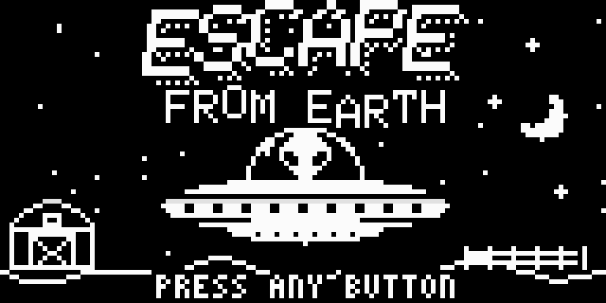
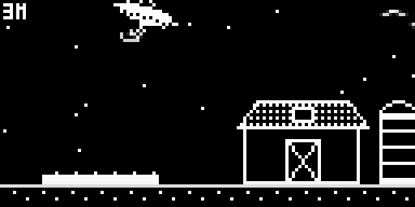
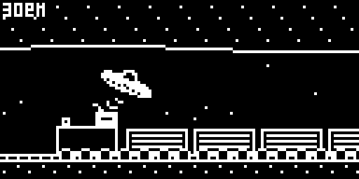
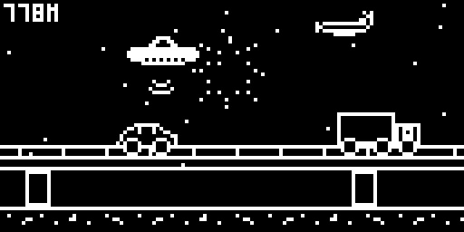
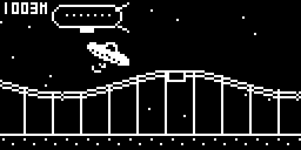
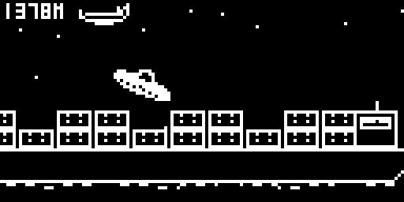
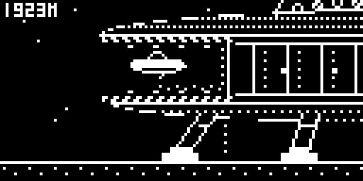

# Escape From Earth



> "I messed with the wrong dairy farmer! We gotta get back to the mothership!" – Glorb

A 1-bit saucer flying game for the **Arduboy FX** (and FX-C, POOM). Fly Glorb's saucer left to right
through one long course and into the waiting mothership. Touch anything and it's over.

By **jaychugstein** · MIT License · Requires the FX flash chip.

 
 
 
 

## The course

The farm, a train tunnel through a mountain, a small town, a highway with a fireworks show, a carnival,
downtown, the harbor, a cave, and Area 51, where the mothership waits with its bay open.
Birds, planes, helicopters, balloons and a blimp fly along the top of the sky, so you can't just hug the ceiling.
Get close to the mothership and its tractor beam pulls you in.

## Controls

| Button | Action |
|---|---|
| Left / Right (or tilt on POOM) | Tilt / steer the saucer |
| B – outer (right) button, hold | Propel. Tap it to hover |
| A – inner (left) button | Spin a quarter turn anticlockwise |

The saucer flies like Pocket Rocket: point it where you want to go and propel.

After a crash or a win, the outer (right) button tries again and the inner (left) button goes back to the home screen.

## Points

| | |
|---|---|
| Distance | 10 points a metre |
| Full 360 | 500 |
| 720 without touching propel | 2,000 |
| 1080 without touching propel | 5,000 (instead of the 720) |
| Upside down | 120 a second |
| Escaping into the mothership | 5,000 |
| Quick escape | 60 a second under 5 minutes |
| Saving propel | 100 for every % of the run you didn't propel |

Escape fast enough for a medal: gold under 70 seconds, silver under 100, bronze under 150.

## Install

**Arduboy FX / FX-C / POOM:** load `release/EscapeFromEarth.hex` together with
`release/EscapeFromEarth-fxdata.bin`, or the packaged `release/EscapeFromEarth.arduboy`, with
any FX-aware uploader (for example the Arduboy Cart Builder, or the Arduboy-Python-Utilities
`uploader.py` + `fxdata-upload.py`).

The game is built with `ARDUBOY_NO_USB` to save space. To upload a different sketch afterwards,
press the reset button when the uploader asks.

## Play in a browser

`docs/` is a ready-to-host page that runs the real game in the Ardens emulator (MIT, by Peter Brown).

## Building from source

The sketch is in `EscapeFromEarth/` and needs the **Arduboy2**, **ArduboyFX** and **ArduboyTones** libraries.

* **Arduino IDE / arduino-cli:** open `EscapeFromEarth/EscapeFromEarth.ino`, select an Arduboy board
  (or Arduino Leonardo), compile and upload, then upload `EscapeFromEarth/fxdata/fxdata.bin` as the FX data.
* **Command line:** `./build.sh` (edit the library paths at the top). Builds `build/EscapeFromEarth.hex`.

The program uses about 27.6 KB of the 28 KB available, so it is close to the limit.
The release hex was built with avr-gcc 14.1; other compiler versions may produce a slightly larger file.

## Where the art comes from

Every picture, the saucer at all 64 angles and the whole course are made by the Python scripts in `art/`
(numpy, scipy and Pillow). To rebuild them and repack the FX data and `fxdata.h`:

```
art/make_all.sh
```
